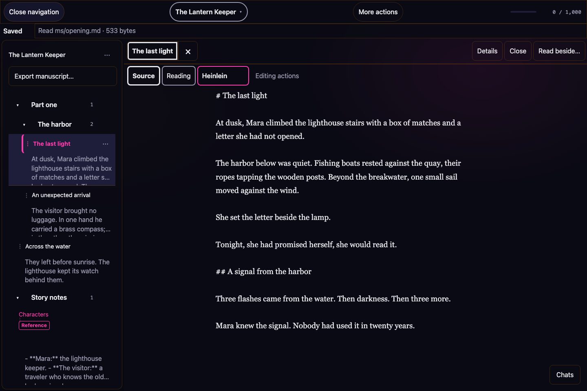
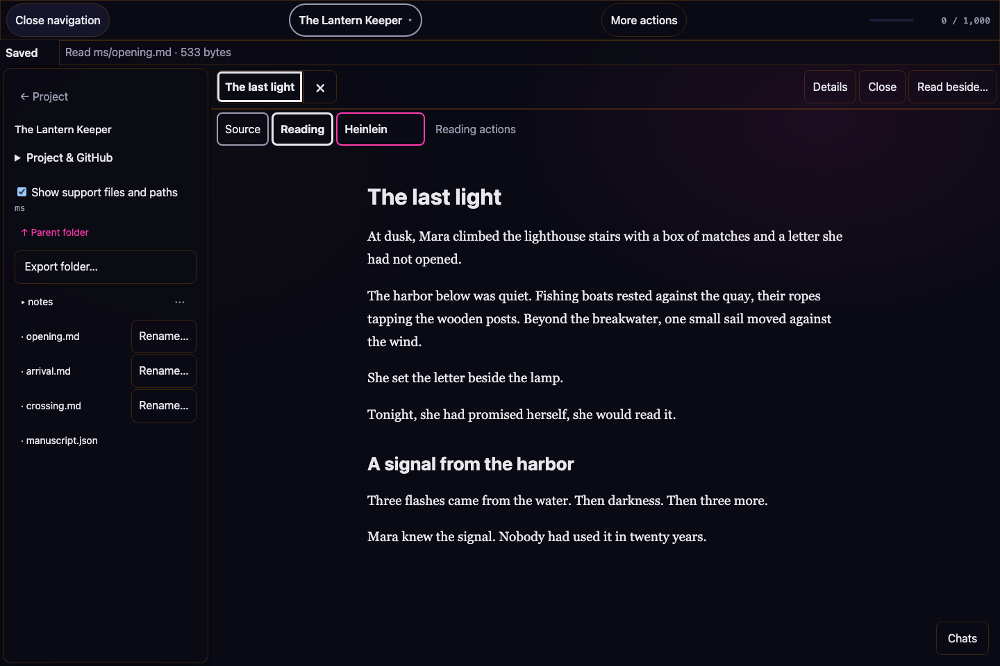

# Heinlein

Heinlein is a local writing workspace and publishing toolkit. Write in ordinary
Markdown files, arrange them into a manuscript in **Heinlein Studio**, and use the
separate publishing CLI to build PDF, EPUB, DOCX, HTML, and plain text with the
**FREE PLAY** imprint design system.

**Start here:** read [How a project works](#how-a-project-works) for the writing
model, [Studio setup](studio/README.md#run) to run the desktop app, or
[Install](#install) to use the publishing CLI.

## How a project works

A project is a folder on your computer. It holds your writing as **sheets**,
organized into folders, with a small index maintained by Heinlein to remember
their order.

- **Sheets are Markdown files.** Each sheet is an ordinary `.md` or `.markdown`
  file. A sheet can hold a scene, part of a chapter, or a note. You can read the
  text in any Markdown editor. Some Studio commands call a sheet a *scene*.
- **Folders organize sheets.** In the Library, these are called *groups*. Groups
  can contain sheets and other groups, so you can arrange a project into parts,
  chapters, or whatever structure suits your writing.
- **The index keeps the order.** Heinlein records sheet identities, titles, paths,
  group membership, and the order you choose. Reading order does not depend on
  alphabetical filenames, and you do not need to renumber files when you move a
  scene.



*Studio's interface with an invented demo project. The screenshots contain no
private manuscript text.*

### Files on disk

A Studio manuscript lives under `ms/` inside its project folder. For example:

```text
My story/
└── ms/
    ├── manuscript.json
    ├── opening.md
    ├── arrival.md
    └── notes/
        └── characters.md
```

The Markdown files contain your words. `ms/manuscript.json` contains the
manuscript's structure and ordering metadata. Newly created sheets normally have
names such as `sheet-<uuid>.md`; their readable titles live in the index. Existing
files can keep descriptive names like those above.

Library groups and disk folders are separate: a group is an arrangement of
sheets in the Library, while **Source files** shows the actual directories. Moving
or renaming a Library item updates its organization or display title without
renaming its Markdown file. Use file operations when you mean to change the path
on disk.



*Source files shows the actual files on disk. Reading shows the selected sheet
with its Markdown formatting.*

### How Heinlein remembers the order

Arrange sheets and groups in the Library with drag-and-drop or the move controls.
Heinlein updates the index for you. Nested groups keep their own sheet order;
viewing or exporting a group follows that arrangement. A sheet keeps its identity
when it moves, even if its place in the story changes. Older manuscripts retain
their existing flat reading order until you explicitly reorganize them.

**Current file format:** Studio stores this index as **JSON** in
`ms/manuscript.json`. The separate **YAML** file, `heinlein.yaml`, configures the
publishing pipeline below; it does not currently store Studio's sheet order.
You do not need to edit either file by hand for everyday writing and arranging
in Studio.

### A simple writing workflow

1. Open a project folder in Studio and set up its Library.
2. Add sheets for your writing, and groups to organize them.
3. Write in the sheets. Studio saves locally; **Save** flushes pending edits.
4. Move sheets or groups when the story's order changes. Heinlein maintains the
   index, while the prose stays in the Markdown files.
5. Use **Export as Markdown…** on a group or project to make a combined copy in
   Library order. The copy includes reference sheets, adds headings, and omits
   sheet YAML frontmatter. Review it before sharing. The source files stay
   unchanged.

Keep the project folder together when making backups or sharing a source copy:
include the Markdown files **and** `ms/manuscript.json` so the arrangement travels
with the writing. Files added outside Heinlein may need explicit inclusion in
the Library. Missing files are reported rather than silently removed from the
index.

### From writing to publishing

The Studio project is your editable source. The publishing CLI works from a
manuscript Markdown file and, optionally, `heinlein.yaml`. That YAML file sets
metadata, output formats, page layout, and output paths.

Studio's optional **First story** guide can prepare a separate, text-only
publishing copy with `manuscript.md`, `heinlein.yaml`, and a source receipt.
The copy is a snapshot: later edits do not synchronize in either direction.
See [the guide and its limits](studio/README.md#your-first-story), then use the
CLI instructions below to build and inspect the output.

## Engineering to explore

- **One source, multiple artifacts:** [the publishing package](heinlein/) combines manuscript metadata, templates, and format-specific rendering.
- **Repeatable project setup:** `heinlein.yaml` records formats, page settings, and output paths; the preview server rebuilds as source files change.
- **Inspectable output:** [tests/](tests/) includes frontmatter, navigation, rendering, and pipeline checks. Full pipeline tests require pandoc and Chrome; see [Tests](#tests).

**Collaborator starting point:** build an [example](examples/), inspect the resulting formats, then trace a rendering or navigation case through the package and its tests. Use sample manuscripts and preserve author-controlled source.

Named after Heinlein because it's the publishing machine for fiction.

## Install

Requires Python 3.11+, [pandoc](https://pandoc.org), and Google Chrome (for PDF).

```sh
git clone https://github.com/Arcadesys/heinlein.git ~/code/heinlein
cd ~/code/heinlein
uv tool install -e .
```

`heinlein` is now on your `PATH`.

## Usage

### One-shot from a manuscript

```sh
heinlein build path/to/manuscript.md --output ./dist --formats pdf,epub
```

The manuscript needs YAML frontmatter:

```yaml
---
title: La Ligne du Marais
subtitle: A Halloween story
author: Austen Tucker
cover: cover.jpg          # relative to the manuscript
genre: short fiction / horror
---

# La Ligne du Marais

*by Austen Tucker*

Tuck spent a month in Paris…
```

The leading `# Title` and `*by Author*` lines get stripped — they're rebuilt on the title page.

### Project mode

Drop a `heinlein.yaml` next to your manuscript:

```yaml
manuscript: manuscript.md
cover: cover.jpg
imprint: free-play
page:
  size: digest             # digest=5.5x8.5, trade=6x9, mass=4.25x6.87
  margins: { top: 0.85in, side: 0.7in }
metadata:
  rights: "© 2026 Austen Tucker. All rights reserved."
  publisher: "FREE PLAY Publishing (a fiction imprint of The Arcades)"
  language: en-US
  cover_eyebrow: "FREE PLAY Publishing · Issue 01 · 2026"
chapters: false           # true for book-length works — see below
formats: [pdf, epub, docx, html, text]
output: dist/
```

### Chapters

Set `chapters: true` in `heinlein.yaml` when the manuscript is a book divided
into chapters (rather than an issue of stand-alone stories). Each `## h2`
becomes a chapter:

- **EPUB / HTML / DOCX** get a clickable Table of Contents listing every
  chapter. In ereaders, the EPUB's depth-2 navigation document drives the
  side-panel chapter list.
- **PDF** gets a side-panel outline (PDF bookmarks) — one entry per chapter
  — generated automatically from the `<h2>` headings by Chrome's print
  engine.

Leave it `false` (the default) for short-fiction issues where each `## h2`
is a separate story.

### Major section breaks

For an afterword or comparable major end matter in a print edition, mark its
H1 heading explicitly:

```md
# Afterword: Pass It On {.major-section-break}
```

The PDF renderer puts one fully blank, unnumbered leaf before that marked
section, so the heading begins on the following page. EPUB, HTML, and DOCX
retain the semantic heading without inserting a blank leaf.

Then:

```sh
cd path/to/project && heinlein build
```

### Flags

| flag                | default     | meaning                                            |
| ------------------- | ----------- | -------------------------------------------------- |
| `--output, -o`      | `./dist`    | Output directory.                                  |
| `--formats, -f`     | `all`       | Comma list of `pdf,epub,docx,html,text` or `all`.  |
| `--debug-html`      | off         | Keep the rendered `print.html` next to the PDF.    |
| `--config`          | auto-find   | Explicit path to a `heinlein.yaml`.                |

### Preview server

```sh
cd path/to/project && heinlein serve
```

Runs a local server (default `http://127.0.0.1:8765`) with:

- **Gallery** at `/` — current project + every archived project with per-format download links.
- **Live preview** at `/preview` — the HTML output in an iframe. Edits to `manuscript.md`, the cover, or `heinlein.yaml` trigger a rebuild and the iframe reloads automatically (SSE).

Add an `archive:` line to `heinlein.yaml` (or pass `--archive PATH`) pointing at a parent directory of past builds — each subdirectory is shown as a card with download links for whatever PDF/EPUB/DOCX/HTML/text artifacts are present.

| flag             | default     | meaning                                   |
| ---------------- | ----------- | ----------------------------------------- |
| `--archive PATH` | unset       | Parent directory of archived projects.    |
| `--port`         | `8765`      | Bind port.                                |
| `--host`         | `127.0.0.1` | Bind host (warns on non-loopback).        |
| `--no-open`      | off         | Don't open the gallery in a browser.      |
| `--no-build`     | off         | Skip the initial build on startup.        |

## Design tokens

The FREE PLAY design system is the source of truth for colours and typography. Tokens live in `heinlein/templates/tokens.css`. To re-sync from the design-system HTML:

```sh
python -m heinlein.scripts.sync_design_tokens \
       --source ~/Downloads/Free\ Play\ Design\ System.html
```

## Tests

```sh
uv run pytest
```

The full pipeline test runs only when both `pandoc` and Chrome are present.

## What it doesn't do (yet)

- MOBI/AZW3 (kindlegen is deprecated; skip).
- Cover image generation.
- Multi-title catalog mode.
- Imprints other than FREE PLAY.

## Heinlein Studio

The native desktop writing app lives in [`studio/`](studio/README.md). It provides
local Markdown editing, autosave and recovery, an ordered Library of sheets and
groups, and explicit export and sharing workflows. See its README for setup,
current features, and verification instructions.
