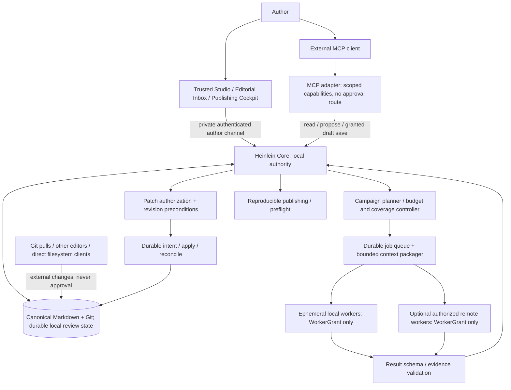
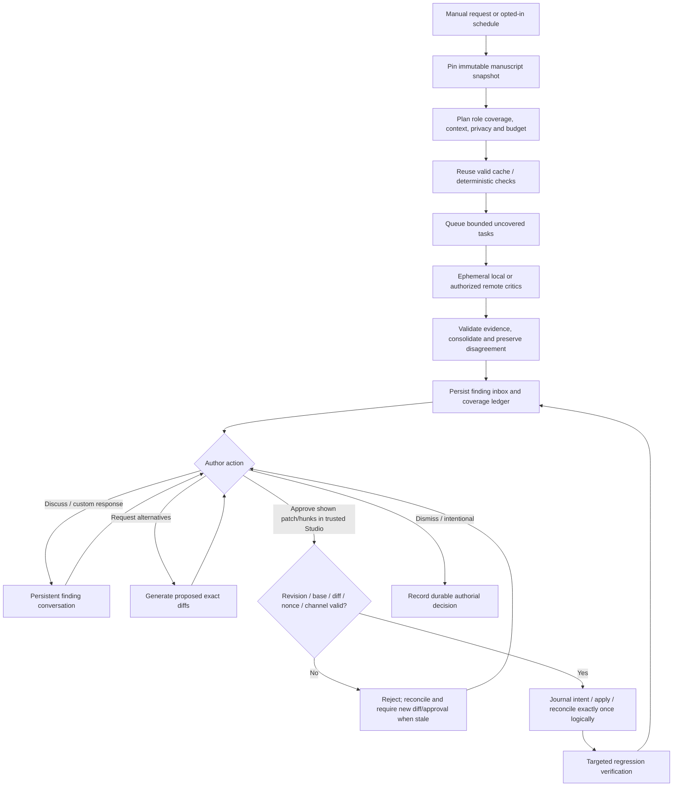
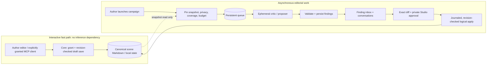
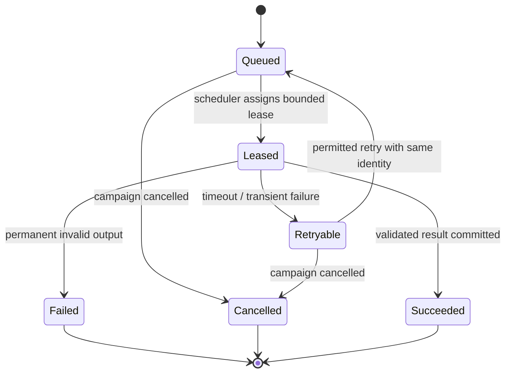
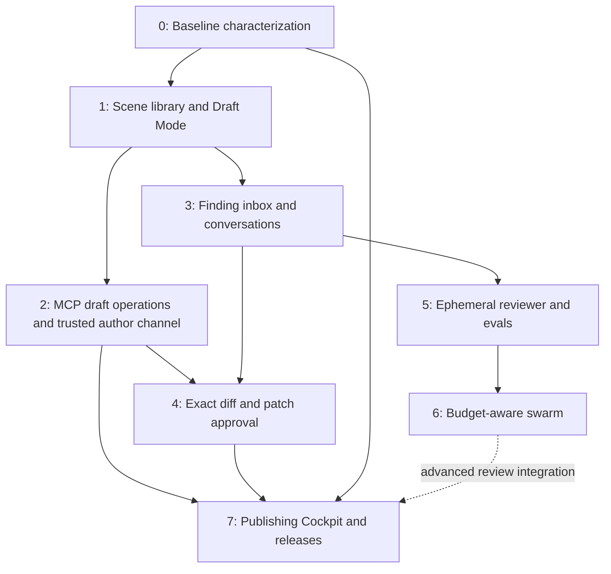

# Heinlein: Orchestration Architecture v0.2.1

**Status:** FROZEN DESIGN BASELINE (proposed architecture, not implemented)  
**Date:** 2026-10-14  
**Next design milestone:** v0.3 Protocol and Contract Specification  
**Scope:** local-first drafting, hybrid editorial orchestration, persistent findings, explicit author approval, MCP, and publishing provenance.

**Proposed authority amendment:** [ADR-001: Drafting, Patch Approval, and Release Authority](adr-001-manuscript-authority.md) defines the authority contract used below. It remains a design amendment under review, not an implementation claim.

> Coordinate a hundred disposable editorial minds without confusing their authority with the author's.

## Compatibility with the current repository

Heinlein currently ships a **Python** Markdown-to-publication pipeline, local preview server, editorial hooks, and voice-protection guidance. This specification describes a **future architecture**. Rust is a candidate for native orchestration infrastructure; TypeScript is a candidate for browser UI. Neither is mandated as a rewrite of working code. Preserve the existing publishing behavior using characterization/integration tests if implementing a new core. No code changes are authorized by this document.

## 1. Frozen decisions

| Concern | Contract |
| --- | --- |
| Execution | Local authority and scheduling, with optional explicitly approved remote workers |
| Campaign initiation | Manual by default; scheduled reviews require explicit opt-in |
| Agent lifetime | Workers are ephemeral; their sessions never constitute durable editorial memory |
| Text authority | Within Heinlein, only Core writes manuscript files. Authors write drafts in Studio or grant scoped MCP drafting. Editorial agents propose edits. Only an author-approved, revision-bound patch applies an editorial change. Only an author-approved snapshot releases. |
| Spending | Adaptive: satisfy declared minimum coverage, prioritize risks, escalate selectively under hard budgets |
| Drafting | Offline-capable, responsive and inexpensive; no AI or remote service in the typing, saving or scene-switch critical path |
| Format | Scene-oriented Markdown as canonical literary content; stable scene IDs and chapter ordering metadata |
| Review state | Durable local findings, conversations, proposals, decisions, coverage and provenance |
| Roles | Arbitrary user-defined, versioned roles; a customizable De-Slopifier is always offered |
| Interfaces | Writing Studio, Publishing Cockpit and MCP share Core validation; author-only commands additionally require the private Studio/Cockpit channel |
| Publications | Builds are traceable to pinned text, edition settings, tool versions and artifacts; releases additionally require snapshot-bound author approval |

Changes to these frozen decisions require an explicit architecture decision record.

## 2. System boundaries



**Control plane vs worker plane:** only the local core may change authority, schedule jobs, commit results, apply approved patches or record author-authorized releases. Workers cannot expand context scope, write canonical text, increase budgets, authorize successors or recursively start new campaigns. Core is the only manuscript writer *within Heinlein*, not an operating-system-wide exclusive writer; external changes follow section 2.3.

**MCP is an adapter, not an agent or privileged backdoor.** Local UI and MCP clients call the same application service and revision/privacy checks. Author-only grant, patch-approval and release-approval operations additionally require the separate trusted channel; sharing Core does not give every transport the same authority.

### 2.1. Draft grants and revision provenance

**Working draft** is the editable manuscript head. **Patch-approved** is an authorization event over an exact change, not a manuscript text state. Applying a patch creates another working-draft revision. **Release-approved** describes a pinned edition snapshot and verified artifacts; subsequent drafting never changes that historical approval.

The author explicitly mints a Core-issued `DraftGrant` in Studio. Its versioned record names the project, allowed stable scene IDs, authenticated MCP client/session, expiry and revocation state. Core validates these fields, the token type and expected revision on every save; grant validation and write acceptance are serialized with revocation. Expired or revoked grants cannot admit new saves. Already durably accepted operations retain their operation IDs for recovery, not reusable permission for later writes. Renewal or broader scope requires another Studio author action.

`DraftGrant`, `WorkerGrant` and the private author-channel credential are distinct capability types with separate Core validators and audiences, not caller-supplied role strings. A worker credential cannot authorize a draft save, request a draft grant, or exchange itself for one. The scheduler never supplies draft grants or author-channel material to workers or context bundles. Draft grants are bound to the authenticated client/session, so copying an identifier or claiming to be that client is insufficient. Editorial workers remain proposal-only; granting an interactive MCP drafting session does not upgrade campaign workers.

Every revision records its actor and client ID, derived from the authenticated session rather than supplied as trusted request text, plus its content origin and separate authorization provenance. Approving an agent proposal does not relabel its origin as author-written. Granted draft saves need no per-save approval, but retain inspectable before/after diffs. Studio visibly lists agent-authored revisions and provides one-click revert as a new, revision-checked change. When later edits make that inverse unsafe, show a conflict instead of overwriting intervening work. Revert never erases the original revision or its provenance.

### 2.2. Authenticated Studio and Cockpit

Author commands use a dedicated local IPC channel between Core and Studio/Cockpit's trusted native host, separate from the MCP listener. A trusted launcher bootstraps a private connected socket/pipe handle and a fresh 256-bit per-launch secret only into those trusted processes. The native host keeps them out of renderer JavaScript, command-line arguments, environment variables, logs, shared files and MCP responses, and does not inherit them into workers or other child processes.

Core authenticates the channel/session and commands, including their arguments, with the per-launch secret and replay protection; v0.3 must specify the canonical authenticated envelope. Patch approvals additionally bind the exact diff, base and one-time approval nonce. Disconnect/relaunch invalidates the old session. A client label, local address, shared OS user or text claiming “Studio” is not authentication. MCP exposes no route to mint/revoke grants or approve patches/releases, and rejects author-channel credentials on its own routes.

The trusted native host owns author confirmation for granting draft access, approving the displayed patch, and approving a release manifest. A browser renderer alone cannot authorize these actions. A browser-only deployment must fail closed on author-only operations until an equivalent trusted approval bridge is specified and tested.

**Threat boundary:** this separates MCP clients and workers from the approval channel under an uncompromised trusted host. It does not claim protection against a process that can inspect/inject the trusted native processes, replace their binaries, or control the author's OS account or confirmation UI. Platform-specific handle isolation, secret-leak tests and process hardening remain implementation acceptance gates, not assumed completed work.

### 2.3. External writers

Git pulls, checkouts, merges, other editors and MCP clients with independent filesystem access can touch manuscript files outside Core. Core detects observed changes through file notifications plus hash/revision reconciliation on startup, open and before mutation or approval. Record them as working-draft revisions with actor `external` and client ID `external:unknown` unless a verified source is available. Git author metadata is evidence, not authenticated Heinlein authorship or consent. Imported tags and commits never manufacture patch or release approval.

External changes invalidate affected expected revisions and pending approvals. Preserve conflicting editor buffers and disk content for reconciliation; never silently overwrite either. An unresolved concurrent external write blocks mutation/approval of the affected source, not local typing. This detection contract does not promise to capture every transient edit between observations or to sandbox all same-user programs.

## 3. Local Draft Mode: first-class acceptance contract

Typing, scene navigation and local persistence **must not await model inference, network calls, cloud identity, remote queues or editorial campaigns**. Make drafts usable offline. Loading small, relevant context is optional and should be cached or computed locally. Agent help is opt-in and scoped.

Provisional measurable targets (not measurements): p95 editor input response <= 50 ms; p95 cached scene switch <= 150 ms; default provider inference cost per ordinary draft edit/save/switch = **$0**. Define platform and test conditions in v0.3. Autosave durability and error reporting require explicit tests. Active review swarms must yield resources to draft mode or pause.

An MCP tool for local reading/saving may itself be inference-free inside Heinlein, although the external AI client may incur model charges. Grant checks, attribution and history are local operations; they must not introduce an inference or network dependency.

## 4. Manuscript and editorial entities

- **ManuscriptSnapshot:** immutable snapshot ID, source Git revision/content hashes, ordered stable scene IDs, dependency/fact-index version.
- **WorkingDraftRevision:** schema version, revision and parent IDs, content hashes, actor, authenticated client ID or explicit external/unknown attribution, content origin, operation/grant/patch references and separate authorization provenance.
- **DraftGrant:** schema version, opaque grant ID and capability type, project, scene IDs, authenticated client/session binding, expiry, revocation state and author issuance event. No worker conversion or delegation.
- **Campaign:** author authorization or opted-in schedule, target snapshot, roles/versions, scope, coverage floor, privacy policy, monetary/token/concurrency caps, status, accounting.
- **Job:** durable ID, idempotency key, task and role versions, context bundle hash, snapshot, allowed tools, provider policy, lease/attempts, outcome.
- **Finding:** ID, provenance, evidence with text anchors and snapshot, impact/severity, claim and alternatives, dedupe links, disposition.
- **Conversation:** persistent author/agent messages, dynamically generated choices, free-form author comments, discussion and decision history.
- **Patch:** candidate ID, linked finding(s), exact hunks/diff, expected source revision, base hash, diff hash, alternatives, author approval event with one-time nonce, journaled application result, verification state.
- **RoleDefinition / EditorialPolicy:** independently versioned instructions, scope, allowed context/tools, output/eval contract, budget and protected choices.
- **EditionBuild:** exact pinned source and configuration, build-tool versions, artifact hashes and preflight outcomes; building alone does not approve a release.
- **ReleaseApproval / ReleaseManifest:** schema versions, source commit, edition/configuration hash, tool versions, verified artifact hashes, displayed provenance-summary boundary, author approval event, annotated tag object ID and release name.

Separate the lifecycles of a finding, its conversation, and its candidate patches. One finding may have several alternative patches; approving one must not erase rejected options or the discussion. Approval events must not be represented as a blanket `approved` flag on the mutable draft.

## 5. Editorial campaign flow



Agents produce **claims and evidence** first. Patch proposals are separate work. The author can accept a suggested option, request investigation, explain an intentional choice, reject, or type a custom response. No text entered in a conversational message counts as patch authorization.

**Mandatory visible diffs:** present old/new text and context; support hunk-level authorization where hunks are independent; for multiple edits show a cumulative diff. The author approves only through authenticated Studio, binding source revision, base hash, diff hash, selected hunks and a one-time nonce. Patches fail closed on stale or changed preconditions. Save or reconcile affected dirty editor buffers before validating approval; never silently merge, overwrite intervening work, or mutate a release snapshot.

**Journaled logical application:** Git, manuscript files and SQLite do not share a transaction. Before mutation, durably journal a stable operation ID, authorization reference, reserved approval nonce, expected base and intended per-file result hashes. Recheck preconditions, apply the file/Git changes, and durably record completion only after reconciling the observed results. Retries of the same operation return its existing result rather than applying it again. A consumed nonce cannot authorize a different operation.

On startup, reconcile unfinished intents against actual file/Git hashes before allowing affected mutations or approvals. Complete an already-applied result, resume only an unambiguous recorded pre-state or attributable partial application, or surface a conflict when the observed state is unexpected. Do not replay blindly, manufacture successful completion, or roll back over external/author changes. Exactly-once means **one logical application with recoverable physical steps**, not cross-store atomic visibility. The same journal discipline covers accepted draft saves, reverts and release-record/tag coordination without putting editorial work in the typing path.

## 6. Ephemeral worker contracts

A task is self-contained: immutable input/context references, role/instruction version, declared output schema, permissions, provider/runner restrictions, budget and deadline. Workers return findings or proposals plus evidence; only core validation can commit them. Worker memory is not authoritative; persistence resides with the core. Worker runtime credentials are `WorkerGrant` capabilities, never `DraftGrant` or author-channel credentials; Core enforces that distinction at every command boundary.

Use durable leases and stable job IDs. Lost workers may be retried without duplicating accepted findings, conversations or patch applications. Cancellation stops new dispatch, preserves completed results and releases unused budget. Partial completion must remain observable.

Remote workers receive only approved scoped manuscript material, short-lived credentials, no unrestricted local filesystem access and no permission to expand their task. Default project privacy is local-only. A remote provider/runner policy must be explicit and auditable.

## 7. Adaptive spending and coverage

Schedule deterministically where possible. AI can recommend prioritization but cannot authorize spend or tool access.

1. Record mandatory coverage floors for the campaign. Full-book deterministic checks may be cheap; semantic roles may explicitly permit sampling.
2. Cache clean results as well as findings. Cache keys must include text/context dependencies, role version, relevant policy/eval versions and model configuration.
3. Run cheap validators and economical screening where suitable.
4. Escalate selectively for high-risk defects, contradictions, ambiguous results and recently modified dependencies.
5. Enforce hard maximum spend, tokens, concurrency, time and retries. Reserve capacity for escalation if configured.
6. Report planned, cached, completed, skipped, failed and unresolved coverage, never labeling a partially sampled or exhausted campaign as fully clean.

Multiple agreeing models do not establish truth. Preserve disagreement with source evidence and avoid treating correlated output as independent votes.

## 8. Roles and authorial policy

The role registry accepts arbitrary specialist definitions. **De-Slopifier** is bundled and configurable: literal/regex/rate-based patterns evaluated cheaply, semantic patterns evaluated only when needed, and protected patterns/approved exceptions. A rejected suggestion does not automatically become project canon; authors explicitly approve durable rule changes.

For the existing author profile, **em dashes are protected**, not a generic AI-writing signal. Intentional fragments, repetitions, interruptions and difficult subject matter must not be indiscriminately sanitized. Consult the existing repository `AGENTS.md` and editorial voice profile; an individual author's policy is not a global default.

## 9. MCP capability surface (conceptual)

- **Resources:** project catalog, scene and chapter snapshots, scoped context/fact sheets, role/policy definitions, finding histories, coverage and build reports.
- **Tools:** list/open projects and scenes, read working drafts, save scoped working drafts using a valid Studio-issued `DraftGrant` and expected revision, open/resume sessions, create/list roles within capability scope, start/status/cancel authorized campaigns, list/get findings, reply to findings, propose/get patches and exact diffs, request preview builds/preflight. No tool mints or revokes grants, approves patches/hunks, authorizes a release, or impersonates the trusted author channel.
- **Prompts:** draft scene, review scene, discuss finding, evaluate alternatives and publication preflight.

MCP capabilities include reader/critic, proposer and explicitly granted working-draft writer; `WorkerGrant` never enables the last of these. Author approver and release authorizer are reserved to authenticated Studio/Cockpit, not MCP permission tiers. An agent cannot impersonate the author, and an MCP client may not bypass revisions or privacy rules. Local clients should not require a public server; exposing remote access is a separate consent/security decision.

## 10. Release and production boundaries

Preview builds may consume a pinned working-draft snapshot without patch or release approval. A release additionally requires an explicit author action in authenticated Cockpit, after the candidate edition is built and its artifacts verified. Before approval, Cockpit displays the **count of non-author revisions since the previous release**, with agent/external breakdown and inspectable history. Count known non-author-origin changes even when their application was author-approved; reverted revisions remain in the history with their reverted status. For the first release use recorded project history; missing provenance is shown as unknown, never silently reported as zero. Bind the displayed summary to the candidate revision so a later change requires refresh.

An annotated Git release tag targets the exact source commit. Its versioned manifest binds edition configuration, build-tool versions and verified PDF/EPUB/etc. hashes. Core records the authenticated approval and tag **object ID**, not only the mutable tag name. Tag creation, Git author metadata, an imported tag or an agent assertion cannot substitute for the approval record. Reject missing/mismatched records, moved or substituted tags and altered artifacts; never reuse a release name within Heinlein. Source, configuration or artifact changes require a new manifest, tag and approval, even when the source commit itself is unchanged.

Subsequent drafting leaves historical release snapshots intact. Patch approval is neither sufficient nor required for release approval. Page/layout QA raises findings without rewriting prose. The author may waive editorial warnings but not an integrity failure that makes a release untrustworthy. The release journal reconciles tag and approval-record persistence after a crash; a partial record is not a releasable edition.

## 11. Failure and adversarial acceptance scenarios

| Scenario | Required invariant |
| --- | --- |
| Worker exits halfway | Retry from durable job state without duplicates |
| Author edits scene mid-campaign | Original reviews remain pinned, impacted findings/checks marked stale |
| Two critics disagree | Retain both claims/evidence and explain uncertainty |
| Budget exhausted | Halt further dispatch; show cost and incomplete coverage |
| Remote runner disappears | Reclaim lease, retry only if permissions and budget allow |
| Author intentionally keeps a passage | Persist scope/version of the authorial decision; avoid automatic rediscovery |
| Patch approved twice | At-most-once manuscript mutation for the same logical operation |
| Source or diff changed after display | Reject stale approval; produce new visible diff |
| Draft grant expires, is revoked or names another scene/client | Deny new save before mutation |
| Worker presents WorkerGrant to draft-save or approval route | Reject by capability type and authenticated audience |
| MCP claims Studio identity or replays an old launch credential | Deny author command; no approval/grant route through MCP |
| Agent revision is reverted after intervening edits | Preserve history; inverse is revision-guarded and cannot overwrite newer work |
| Git pull or external editor changes a manuscript | Record observed external working-draft revision; never infer approval |
| Crash between intent, file/Git update and SQLite completion | Reconcile operation ID and before/after hashes; no blind replay or lost provenance |
| Agent/external changes exist before release | Show candidate-bound non-author revision count before author confirmation |
| Tag exists without matching approval, moves, or artifacts change | Block release; tag name or creation is not consent |
| Role/policy changes | New version; no reinterpretation of past campaigns |
| Verification finds regression | Report finding; never silently roll back or overwrite authorial text |
| Cloud unavailable while drafting | Editor, scene switching and local saves remain usable |
| Build fails before release approval | Preserve source and report failure; no release of invalid output |

## 12. Frozen invariants

1. Heinlein-mediated agent draft writes require a live scoped author grant, visible revision history and attribution; editorial workers cannot write manuscript text.
2. Every editorial proposal has an inspectable exact diff; every granted draft save retains inspectable before/after history.
3. Editorial patch application requires a specific authenticated Studio author action bound to source revision, base hash, diff hash and one-time nonce. A draft grant authorizes only scoped working-draft saves, never patch or release approval.
4. Every finding is anchored to evidence and a snapshot.
5. Agent execution is ephemeral; editorial memory is durable.
6. Workers cannot elevate privilege, expand budgets or self-schedule.
7. Job retry and logical patch application are idempotent through durable identities and reconciliation.
8. Coverage is honest about skipped, sampled and failed work.
9. Protected stylistic choices outrank generic editorial heuristics.
10. Local draft operations do not depend on inference or remote availability.
11. Released artifacts are traceable to the exact author-approved snapshot, configuration, tool versions, artifact hashes and annotated tag object ID.
12. Author decisions remain reviewable, including intentionally unmodified text.
13. Failure recovery reconciles journaled intent with actual files/Git state; it never assumes a shared Git/SQLite transaction or overwrites unexpected external changes.
14. MCP observes the same Core revision/privacy guards as UI but cannot access the private author-approval channel or its capabilities.

## 13. Open design decisions (not implementation blockers)

- Batch approval: permitted when exact cumulative diffs and included patches are presented through authenticated Studio.
- Cross-project policies: explicit versioned profile import/opt-in, never silent.
- Follow-up agents: scheduler-controlled escalation only, inside the original budget.
- Unresolved editorial warnings: explicit author waiver can permit publishing; integrity failures remain blocking.
- Detailed scene schema, transaction/event semantics, cache invalidation, context minimization, and worker protocol remain to be specified. ADR-001 fixes the authority and recovery direction; platform enforcement and exhaustive crash/abuse tests remain unverified.

## 14. v0.3: Protocol and Contract Specification (next, not yet frozen)

Produce language-agnostic, reviewable contracts with example JSON messages **but no implementation code**:

1. Schemas and identifiers for snapshots, draft grants/revisions, author approval events, release manifests, campaigns, jobs, findings, conversations, patches and role/policy versions.
2. Event names, persistence semantics, journal/reconciliation ordering, state-transition guards and idempotency.
3. MCP tool/resource/prompt definitions, sessions, typed capabilities and error contracts; private author-channel bootstrap, authenticated envelopes, replay guards and secret isolation.
4. Worker input/output, leasing, cancellation, heartbeats, retries and remote privacy policy.
5. Exact diff, base-hash/stale-revision checks, hunk approval, one-time nonce reservation and journaled logical application rules.
6. Budget accounting, coverage reporting, cache invalidation and escalation thresholds.
7. Offline draft-mode performance benchmarks and write/durability guarantees, including external-change detection and attribution.
8. Contract tests and a full sequence diagram from review request through verified patch and reproducible build/release approval.

**Review request for Claude:** challenge trust boundaries, races between draft saves and patch approvals, schema evolution, failure recovery, cache correctness, the cost of local Draft Mode, and how v0.3 should formalize the contracts. Distinguish actual repo behavior from planned future architecture. Do not write implementation code until the author accepts the protocol design.

---

# Appendix A: Architectural walkthrough and delivery slices

This appendix is **design detail for review**, including the proposed ADR-001 authority amendment. Sequence and topology diagrams are illustrative and intentionally avoid implementation-specific transports except where the authority boundary requires one. Each slice must be reversible, testable, and demonstrably useful without requiring the next slice.

## A1. Why these boundaries exist

Heinlein has three time scales: (1) a keystroke or local scene save, (2) a focused assistant interaction, and (3) a long-running editorial campaign. They must not share blocking execution paths. The durable local authority receives authenticated commands, checks revisions, records events, and coordinates workers. Ephemeral workers cannot hold exclusive locks on the draft editor.



### Drafting latency isolation

Input, selection, undo/redo and render cannot depend on filesystem sync, agent completion or network. Draft edits enter the editor's local change buffer; persistence is scheduled and durable failure is surfaced. Saving via MCP and via UI uses the same expected-revision guards; MCP also requires its scoped `DraftGrant`. Background workers operate on snapshots, never on live editor buffers. Resource contention is measurable: throttle CPU-intensive local reviews and avoid unbounded indexing while the user is typing.

**Proposed benchmark gates:** steady-state p95 keystroke response <= 50 ms and cached scene navigation <= 150 ms on a defined reference machine and reference manuscript; ordinary edits trigger zero provider calls; disconnected network cannot break a local save. Until benchmark methodology is defined, these are targets, not promises of achieved performance.

## A2. Editorial request through verified change: sequence diagram

```mermaid
sequenceDiagram
  autonumber
  actor Author
  participant UI as Discussion UI or MCP Client
  participant Studio as Trusted Studio Native Host
  participant Core as Local Heinlein Core
  participant DB as Durable State / Intent Journal
  participant Files as Manuscript Files / Git
  participant Sched as Scheduler
  participant Critic as Ephemeral Critic
  participant Editor as Ephemeral Proposer
  Author->>UI: Start scoped review
  UI->>Core: Request campaign with budget / policy
  Core->>DB: Freeze snapshot + save campaign and jobs
  Core->>Sched: Dispatch bounded job plan
  Sched->>Critic: Minimal context + versioned role contract + WorkerGrant
  Critic-->>Core: Finding + quoted evidence + source references
  Core->>DB: Validate and commit result idempotently
  Critic--xCritic: Exit / discard session
  Core-->>UI: Finding available
  Author->>UI: Choose an option or enter free text
  UI->>Core: Append discussion message
  Core->>DB: Persist conversation
  Author->>UI: Request patch alternative
  Core->>Editor: Bounded proposal task on pinned source + WorkerGrant
  Editor-->>Core: Candidate patch
  Editor--xEditor: Exit
  Core->>DB: Store patch and exact diff
  Core-->>Studio: Display contextual before/after diff
  Author->>Studio: Save/reconcile affected buffer; approve exact patch/hunks
  Studio->>Core: Private authenticated channel: revision + base hash + diff hash + nonce
  alt expected source/hashes match and channel/nonce valid
    Core->>DB: Durably journal operation ID, intent and reserved nonce
    Core->>Files: Apply recorded change after precondition check
    Core->>DB: Record completion after result-hash reconciliation
    Core->>Sched: Schedule targeted verification
  else source/diff changed or auth invalid
    Core-->>Studio: Reject / mark stale / require new diff and approval
  end
  Note over Core,Files: Startup reconciles unfinished intent; no shared Git/SQLite transaction
  Sched-->>Core: Verified findings / regression results
  Core->>DB: Record outcome and coverage
  Core-->>Studio: Show working-draft revision and verification status
```

**Recovery contract:** section 5 defines durable intent, apply order and startup reconciliation for exactly-once *logical* application. v0.3 must turn that contract into explicit per-step crash/replay tests. MCP can discuss or propose a patch but never submits the author approval command.

## A3. Worker lease and replay state



A late result after lease expiration must not blindly overwrite the winning attempt. Retries carry stable job IDs plus unique attempt IDs; the core checks the lease epoch and idempotency key. Duplicate findings can be linked but never silently dropped if the claims materially differ.

## A4. Vertical slices: proposed implementation order

### Slice 0: Characterize and protect existing behavior

**User value:** Heinlein's existing Python publication flow keeps working throughout the evolution.

**Scope:** inventory current CLI formats, frontmatter, preview server, templates, writer rules and tests; assemble golden input/output cases and fixture projects. Define an ADR ledger that distinguishes frozen requirements from current code.

**Demo:** build the same example using the existing CLI; show deterministic structural assertions and render comparisons.

**Exit gate:** current build and preview behavior is understood and testable; no new service is required. **Non-goals:** rewrite to Rust, new editor, agent swarms.

### Slice 1: Scene library + fast local Draft Mode

**User value:** create/open/reorder scenes as small Markdown segments, edit without inference or cloud connectivity, and recover saves.

**Scope:** stable scene IDs, manifest and scene metadata, filesystem import/export to existing manuscript builds, local editor or minimal UI, autosave, conflict detection and crash-recovery rules; external file modifications are recognized and attributed as external working-draft revisions. Every revision carries actor/client identity or explicit unknown attribution.

**Demo:** import one story; split into scenes; reorder scenes without renaming all files; write offline; restart; produce the same publication as pre-split source (allowing defined normalization). Edit outside Heinlein and show the external revision without an approval event.

**Exit gate:** no provider calls for type/save/switch; benchmark p95 latency; crash test with unsaved changes and obvious recovery UI; preserve Markdown without lossy round-trip; external changes cannot silently overwrite dirty buffers or acquire approval. **Non-goals:** full custom publishing cockpit, swarm engine.

### Slice 2: MCP-first draft access

**User value:** an explicitly authorized external assistant can find, read and save a scoped working scene without loading the whole book.

**Scope:** local MCP discovery/session/context and expected-revision draft-save tools; trusted Studio/Core author-channel bootstrap; author-minted `DraftGrant` with project/scene/client/session scope, expiry and revocation; distinct non-convertible `WorkerGrant` validators; attributed revision history and one-click safe revert; capability denial and error contracts. MCP has no author-approval or grant-minting route.

**Demo:** mint a grant in Studio; read and save a named scene through its bound MCP client; inspect and revert the agent revision. Deny a stale save, another scene/client, an expired/revoked grant and a worker credential. Attempt to impersonate Studio through MCP and verify rejection; use the editor offline.

**Exit gate:** UI and MCP observe identical local state and revision/privacy guards without sharing approval authority; no AI required inside Heinlein for MCP file operations; unauthorized clients cannot read other projects; launch-secret/handle isolation and provenance/revert behavior are tested. **Non-goals:** remote public MCP exposure or protection from a compromised trusted host.

### Slice 3: Durable editorial findings and discussion

**User value:** review a finding, select generated choices, type a custom instruction, dismiss it, and return tomorrow to the same conversation.

**Scope:** SQLite-backed findings, provenance, conversation threads, issue/intentional dispositions, versioned authorial policy, read-only reviewer role; import results from a fixture or a single bounded worker.

**Demo:** run a continuity critic on Scene 18, compare evidence to Scene 23, discuss the issue, store “intentional” explanation, restart and verify the decision persists.

**Exit gate:** no critic can modify canonical text; rejection is durable but appropriately scoped; erroneous agent claims are never automatically promoted to canon. **Non-goals:** large swarm, automatic patching.

### Slice 4: Diff-first patch workflow

**User value:** see exact revisions, approve one hunk or decline an alternative, and never lose an intervening manual edit.

**Scope:** patches as distinct objects, line/context anchors, full before/after diff, competing patch alternatives, private Studio author approval bound to revision/base/diff/nonce, stale-source detection, application journal and startup reconciliation, and targeted verification event.

**Demo:** approve a single visible hunk, reject another, then intentionally edit the source before approving a stale patch; stale approval fails and shows a refreshed proposal, not a silent merge. Crash at intent, file/Git update and completion boundaries; retry the same operation without double application.

**Exit gate:** replayed approval does not double-edit; changed diff/base and reused nonce fail closed; crashes have recoverable outcomes without overwriting unexpected external changes; patch-event and resulting working-draft provenance are auditable. **Non-goals:** inferred approvals from plain-text chat or cross-store atomicity claims.

### Slice 5: Ephemeral single-worker execution + eval fixture

**User value:** run a role such as De-Slopifier with a known cost ceiling, collect source-anchored claims, discard the worker, and preserve results.

**Scope:** task envelopes, provider adapters, bounded context, role versions, validation, deterministic regex/rule scanning, opt-in semantic scan, cancellation and per-job spend; a small evaluation corpus.

**Demo:** run De-Slopifier against a test scene with author-configured “It's not X, it's Y” and punchy-fragment heuristics; verify protected em dashes are never flagged by the bundled author profile. Kill the agent mid-run, retry safely, reopen persistent results.

**Exit gate:** ephemeral workers have no canonical write permission or `DraftGrant`/author-channel material; repeat inputs reuse eligible cached checks; results include quality and token/spend telemetry. **Non-goals:** mass parallelism.

### Slice 6: Campaign scheduler + adaptive swarm

**User value:** author initiates an editorial campaign with arbitrary roles and a hard budget; progress, quality and partial coverage stay intelligible.

**Scope:** durable queue, leases, scheduler-only fan-out, provider tiers, concurrency controls, cache dependencies, risk-based escalation, sample-vs-complete coverage reporting and cancellation. Begin local-only, then add allowlisted remote runners with explicit privacy consent.

**Demo:** run 3 distinct critic roles across a small book; deliberately fail one worker, exhaust a tiny budget and change a source scene; show resumed jobs, incomplete coverage honesty, invalidation and precise cost ledger.

**Exit gate:** no unbounded spend or recursive dispatch; workers respect author privacy; local editor stays responsive during heavy review. **Non-goals:** unbounded swarm size as a product goal.

### Slice 7: Publishing Cockpit + immutable releases

**User value:** preview a pinned draft and explicitly release a print or ebook edition with traceable source and artifacts.

**Scope:** reuse existing Python publishing pipeline initially; edition settings, build identity, EPUB/PDF QA, layout diagnostics, candidate-bound non-author revision count/history, versioned release manifest, authenticated Cockpit approval, annotated tag object ID and matching Core record.

**Demo:** build PDF and EPUB from a pinned draft, inspect the non-author revision count, fix a layout/preflight defect without rewriting prose, rebuild and approve the exact artifacts. Record a release tag/manifest, continue drafting, and show that the prior release remains unchanged. An imported or moved tag cannot create approval.

**Exit gate:** release build is reproducible as far as toolchain permits; failures do not mutate manuscript; author waivers for editorial warnings are logged; release approval binds source/configuration/tools/artifacts and tag object ID; interrupted tag/record writes reconcile without treating a partial release as approved. **Non-goals:** replacing working rendering stack without demonstrated need.

## A5. Dependency graph between slices



**Pragmatic sequencing note:** establish end-to-end vertical value early. A basic publication build already exists; Slice 7 enhances, rather than delays, that function. MCP draft access may be implemented in parallel with the findings UI once Slice 1's scene and revision contracts are stable. The trusted author-channel foundation in Slice 2 is required before author patch/release commands, even in a UI-only deployment.

## A6. Cross-slice contract table

| Capability | First owner | Guard / test |
| --- | --- | --- |
| Stable scene IDs and ordering | Slice 1 | Reorder does not invalidate identity |
| Local revision preconditions and external attribution | Slice 1 | Stale write rejects; external edit never approves |
| MCP auth, typed draft grants and bounded scene context | Slice 2 | Wrong scope/client/type and expired/revoked grant denied |
| Private author channel and secret isolation | Slice 2 | MCP/worker impersonation and launch replay denied |
| Agent revision history and safe revert | Slice 2 | Attribution persists; inverse cannot overwrite newer work |
| Durable finding provenance | Slice 3 | Restart maintains anchored claims |
| Authorial decision memory | Slice 3 | Rejection not silently elevated to global rule |
| Exact diff and approval event | Slice 4 | Revision/base/diff/nonce bound; no blanket approved-text state |
| Journaled logical patch application | Slice 4 | Per-step crash/replay reconciles without double application |
| Worker boundary / role contracts | Slice 5 | WorkerGrant cannot authorize draft saves or approval |
| Idempotent job execution | Slice 5 → 6 | Crash/retry duplicate-free |
| Coverage, budgets, adaptive escalation | Slice 6 | Hard spend cap, honest incomplete review |
| Release snapshot, manifest and tag object identity | Slice 7 | Non-author count shown; bare/moved tag cannot approve |

## A7. What Claude should try to break

1. **Save/approval race:** the editor has unsaved buffer changes while an MCP client proposes a patch against the last persisted revision. Try to bypass Studio's save/reconcile step or Core's revision/base/diff/nonce checks; neither a stale buffer nor a granted draft save may silently overwrite the other.
2. **Split-brain state:** kill Core after each journal, file/Git and SQLite-completion step. Startup must reconcile the operation ID and before/after hashes, not replay over external edits or claim a cross-store transaction.
3. **Stale dependency cache:** Scene 18 is unchanged, but a fact learned in Scene 23 moved to Scene 17. Which continuity results are invalidated?
4. **Correlated critic consensus:** many similar models agree on a false issue. What's the evidentiary escalation policy?
5. **Privacy envelope:** does a remote context bundle disclose the character bible, confidential unpublished drafts, or embedded credentials beyond necessity?
6. **Semantic De-Slopifier exceptions:** can a broad author rule wrongly suppress genuine narrative defects? How are exceptions scoped and audited?
7. **Budget accounting:** provider timeouts and retries can incur charges despite no result. How are reserved, estimated and actual spend reconciled?
8. **MCP permission confusion:** try a WorkerGrant on draft-save, another client's DraftGrant, a forged Studio label, a leaked renderer value, an expired launch session, or conversational “yes.” None may mint a grant or approve a patch/release; test secret/handle exclusion rather than relying on policy text.
9. **Markup preservation:** does rich-text round-tripping mutate Markdown extensions, emphasis, punctuation or intentional formatting?
10. **Desktop responsiveness:** can background Rust/Python parsing, Git operations or local model inference starve the editor process?
11. **Release consistency:** try hiding agent/external revisions, moving a release tag, changing artifacts after approval, or interrupting tag/record persistence. The candidate-bound summary and exact manifest/tag object/approval binding must fail closed.
12. **Backward-compatible migration:** can the current Python CLI remain first-class while a new orchestration core is introduced incrementally?

**v0.3 deliverable:** resolve these questions in protocol/state-transition contracts and example payloads, plus test cases. ADR-001 records the selected authority direction, not proof that its enforcement is implemented. Do not build the worker runtime or editor until the contracts are reviewed.
