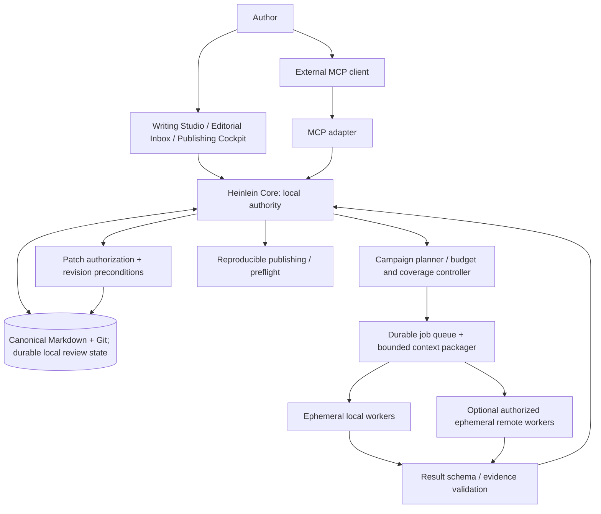
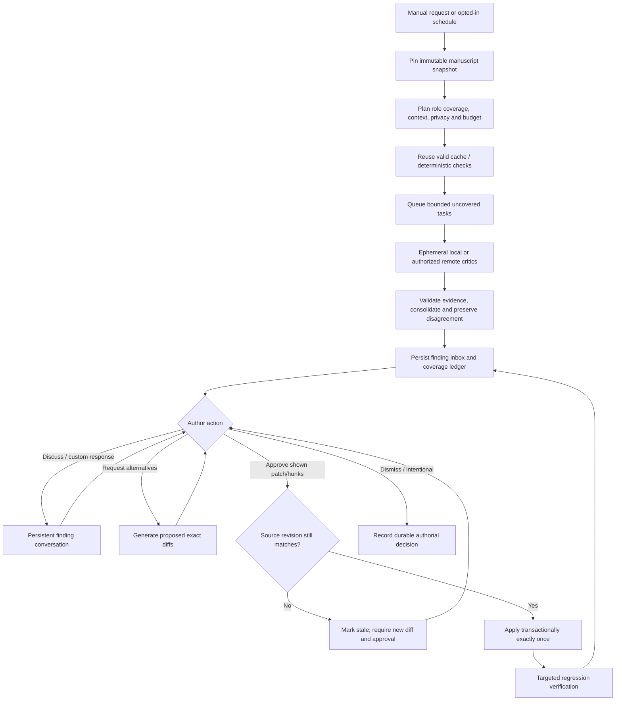

# Heinlein: Orchestration Architecture v0.2.1

**Status:** FROZEN DESIGN BASELINE (proposed architecture, not implemented)  
**Date:** 2026-10-14  
**Next design milestone:** v0.3 Protocol and Contract Specification  
**Scope:** local-first drafting, hybrid editorial orchestration, persistent findings, explicit author approval, MCP, and publishing provenance.

> Coordinate a hundred disposable editorial minds without confusing their authority with the author's.

## Compatibility with the current repository

Heinlein currently ships a **Python** Markdown-to-publication pipeline, local preview server, editorial hooks, and voice-protection guidance. This specification describes a **future architecture**. Rust is a candidate for native orchestration infrastructure; TypeScript is a candidate for browser UI. Neither is mandated as a rewrite of working code. Preserve the existing publishing behavior using characterization/integration tests if implementing a new core. No code changes are authorized by this document.

## 1. Frozen decisions

| Concern | Contract |
| --- | --- |
| Execution | Local authority and scheduling, with optional explicitly approved remote workers |
| Campaign initiation | Manual by default; scheduled reviews require explicit opt-in |
| Agent lifetime | Workers are ephemeral; their sessions never constitute durable editorial memory |
| Text authority | Agents may read, criticize, converse, and propose; only a displayed, revision-specific, author-approved patch may change approved manuscript text |
| Spending | Adaptive: satisfy declared minimum coverage, prioritize risks, escalate selectively under hard budgets |
| Drafting | Offline-capable, responsive and inexpensive; no AI or remote service in the typing, saving or scene-switch critical path |
| Format | Scene-oriented Markdown as canonical literary content; stable scene IDs and chapter ordering metadata |
| Review state | Durable local findings, conversations, proposals, decisions, coverage and provenance |
| Roles | Arbitrary user-defined, versioned roles; a customizable De-Slopifier is always offered |
| Interfaces | Writing Studio, Publishing Cockpit and MCP share core validation/authorization rules |
| Publications | Builds are traceable to approved text, edition settings, tool versions and artifacts |

Changes to these frozen decisions require an explicit architecture decision record.

## 2. System boundaries

**Control plane vs worker plane:** only the local core may change authority, schedule jobs, commit results, apply approved patches or authorize releases. Workers cannot expand context scope, write canonical text, increase budgets, authorize successors or recursively start new campaigns.

**MCP is an adapter, not an agent or privileged backdoor.** Local UI and MCP clients call the same application service and permission checks. The UI need not internally use MCP as its transport.

## 3. Local Draft Mode: first-class acceptance contract

Typing, scene navigation and local persistence **must not await model inference, network calls, cloud identity, remote queues or editorial campaigns**. Make drafts usable offline. Loading small, relevant context is optional and should be cached or computed locally. Agent help is opt-in and scoped.

Provisional measurable targets (not measurements): p95 editor input response <= 50 ms; p95 cached scene switch <= 150 ms; default provider inference cost per ordinary draft edit/save/switch = **$0**. Define platform and test conditions in v0.3. Autosave durability and error reporting require explicit tests. Active review swarms must yield resources to draft mode or pause.

An MCP tool for local reading/saving may itself be inference-free inside Heinlein, although the external AI client may incur model charges.

## 4. Manuscript and editorial entities

- **ManuscriptSnapshot:** immutable snapshot ID, source Git revision/content hashes, ordered stable scene IDs, dependency/fact-index version.
- **Campaign:** author authorization or opted-in schedule, target snapshot, roles/versions, scope, coverage floor, privacy policy, monetary/token/concurrency caps, status, accounting.
- **Job:** durable ID, idempotency key, task and role versions, context bundle hash, snapshot, allowed tools, provider policy, lease/attempts, outcome.
- **Finding:** ID, provenance, evidence with text anchors and snapshot, impact/severity, claim and alternatives, dedupe links, disposition.
- **Conversation:** persistent author/agent messages, dynamically generated choices, free-form author comments, discussion and decision history.
- **Patch:** candidate ID, linked finding(s), exact hunks/diff, expected source revision, alternatives, approvals, application result, verification state.
- **RoleDefinition / EditorialPolicy:** independently versioned instructions, scope, allowed context/tools, output/eval contract, budget and protected choices.
- **EditionBuild:** exact approved source and configuration, build-tool versions, artifact hashes and preflight outcomes.

Separate the lifecycles of a finding, its conversation, and its candidate patches. One finding may have several alternative patches; approving one must not erase rejected options or the discussion.

## 5. Editorial campaign flow

Agents produce **claims and evidence** first. Patch proposals are separate work. The author can accept a suggested option, request investigation, explain an intentional choice, reject, or type a custom response. No text entered in a conversational message counts as patch authorization.

**Mandatory visible diffs:** present old/new text and context; support hunk-level authorization where hunks are independent; for multiple edits show a cumulative diff. Patches must fail closed on stale source revisions. Never silently merge or rewrite approved work.

## 6. Ephemeral worker contracts

A task is self-contained: immutable input/context references, role/instruction version, declared output schema, permissions, provider/runner restrictions, budget and deadline. Workers return findings or proposals plus evidence; only core validation can commit them. Worker memory is not authoritative; persistence resides with the core.

Use durable leases and stable job IDs. Lost workers may be retried without duplicating accepted findings, conversations or patch applications. Cancellation stops new dispatch, preserves completed results and releases unused budget. Partial completion must remain observable.

Remote workers receive only approved scoped manuscript material, short-lived credentials, no unrestricted local filesystem access and no permission to expand their task. Default project privacy is local-only. A remote provider/runner policy must be explicit and auditable.

## 7. Adaptive spending and coverage

Schedule deterministically where possible. AI can recommend prioritization but cannot authorize spend or tool access.

1. Record mandatory coverage floors for the campaign. Full-book deterministic checks may be cheap; semantic roles may explicitly permit sampling.
2. Cache clean results as well as findings. Cache keys must include text/context dependencies, role version, relevant policy/eval versions and model configuration.
3. Run cheap validators and economical screening where suitable.
4. Escalate selectively for high-risk defects, contradictions, ambiguous results and recently modified dependencies.
5. Enforce hard maximum spend, tokens, concurrency, time and retries. Reserve capacity for escalation if configured.
6. Report planned, cached, completed, skipped, failed and unresolved coverage, never labeling a partially sampled or exhausted campaign as fully clean.

Multiple agreeing models do not establish truth. Preserve disagreement with source evidence and avoid treating correlated output as independent votes.

## 8. Roles and authorial policy

The role registry accepts arbitrary specialist definitions. **De-Slopifier** is bundled and configurable: literal/regex/rate-based patterns evaluated cheaply, semantic patterns evaluated only when needed, and protected patterns/approved exceptions. A rejected suggestion does not automatically become project canon; authors explicitly approve durable rule changes.

For the existing author profile, **em dashes are protected**, not a generic AI-writing signal. Intentional fragments, repetitions, interruptions and difficult subject matter must not be indiscriminately sanitized. Consult the existing repository `AGENTS.md` and editorial voice profile; an individual author's policy is not a global default.

## 9. MCP capability surface (conceptual)

- **Resources:** project catalog, scene and chapter snapshots, scoped context/fact sheets, role/policy definitions, finding histories, coverage and build reports.
- **Tools:** list/open projects and scenes, read/write working drafts with expected revisions, open/resume sessions, create/list roles, start/status/cancel campaigns, list/get findings, reply to findings, propose/get patches and exact diffs, approve patch/hunks with author capabilities, build/preflight editions.
- **Prompts:** draft scene, review scene, discuss finding, evaluate alternatives and publication preflight.

Permission tiers are capabilities, not identity labels: reader/critic, proposer, working-draft writer, author approver, publisher. An agent cannot impersonate the author, and an MCP client may not bypass revisions or privacy rules. Local clients should not require a public server; exposing remote access is a separate consent/security decision.

## 10. Release and production boundaries

Freeze an explicitly approved manuscript revision for each edition. A publishing build consumes a pinned source, layout/edition configuration and build environment. Store hashes of generated PDF/EPUB/etc. Artifacts must be traceable to inputs; page/layout QA can raise findings without rewriting approved prose. The author may waive editorial warnings but not an integrity failure that makes a release untrustworthy.

## 11. Failure and adversarial acceptance scenarios

| Scenario | Required invariant |
| --- | --- |
| Worker exits halfway | Retry from durable job state without duplicates |
| Author edits scene mid-campaign | Original reviews remain pinned, impacted findings/checks marked stale |
| Two critics disagree | Retain both claims/evidence and explain uncertainty |
| Budget exhausted | Halt further dispatch; show cost and incomplete coverage |
| Remote runner disappears | Reclaim lease, retry only if permissions and budget allow |
| Author intentionally keeps a passage | Persist scope/version of the authorial decision; avoid automatic rediscovery |
| Patch approved twice | At-most-once manuscript mutation |
| Source changed after diff | Reject stale approval; produce new visible diff |
| Role/policy changes | New version; no reinterpretation of past campaigns |
| Verification finds regression | Report finding; never silently roll back or overwrite authorial text |
| Cloud unavailable while drafting | Editor, scene switching and local saves remain usable |
| Build fails after approval | Preserve source and report failure; no release of invalid output |

## 12. Frozen invariants

1. Manuscript text is never silently changed by agents.
2. Every proposed edit has an inspectable exact diff.
3. Approved text changes require a specific, authenticated, revision-bound author action.
4. Every finding is anchored to evidence and a snapshot.
5. Agent execution is ephemeral; editorial memory is durable.
6. Workers cannot elevate privilege, expand budgets or self-schedule.
7. Job retry and patch application are idempotent.
8. Coverage is honest about skipped, sampled and failed work.
9. Protected stylistic choices outrank generic editorial heuristics.
10. Local draft operations do not depend on inference or remote availability.
11. Publication artifacts are traceable to exact approved inputs.
12. Author decisions remain reviewable, including intentionally unmodified text.
13. Failure recovery does not sacrifice state consistency.
14. External MCP access observes the same authorization boundaries as the UI.

## 13. Open design decisions (not implementation blockers)

- Batch approval: permitted when exact cumulative diffs and included patches are presented.
- Cross-project policies: explicit versioned profile import/opt-in, never silent.
- Follow-up agents: scheduler-controlled escalation only, inside the original budget.
- Unresolved editorial warnings: explicit author waiver can permit publishing; integrity failures remain blocking.
- Detailed scene schema, transaction/event semantics, cache invalidation, context minimization, and worker protocol remain to be specified.

## 14. v0.3: Protocol and Contract Specification (next, not yet frozen)

Produce language-agnostic, reviewable contracts with example JSON messages **but no implementation code**:

1. Schemas and identifiers for snapshots, campaigns, jobs, findings, conversations, patches and role/policy versions.
2. Event names, persistence semantics, state-transition guards and idempotency.
3. MCP tool/resource/prompt definitions, sessions, permissions and error contracts.
4. Worker input/output, leasing, cancellation, heartbeats, retries and remote privacy policy.
5. Exact diff, stale-revision, hunk approval and atomic application rules.
6. Budget accounting, coverage reporting, cache invalidation and escalation thresholds.
7. Offline draft-mode performance benchmarks and write/durability guarantees.
8. Contract tests and a full sequence diagram from review request through verified patch and reproducible build.

**Review request for Claude:** challenge trust boundaries, races between draft saves and patch approvals, schema evolution, failure recovery, cache correctness, the cost of local Draft Mode, and how v0.3 should formalize the contracts. Distinguish actual repo behavior from planned future architecture. Do not write implementation code until the author accepts the protocol design.
